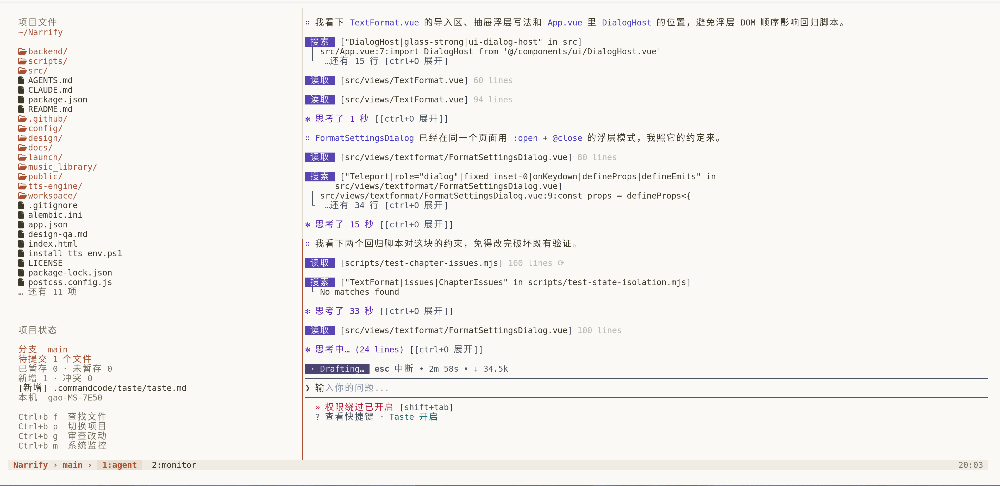

# Claude 米白终端工作台

把已固化的 Ghostty + tmux 工作台交给智能体完整复刻，包含配置模板、部署脚本、备份与回退；不是只有一段风格提示词。

## 实际效果



上图为实际运行截图：左侧查看项目文件、分支和改动；右侧运行 Agent CLI；底部显示 `项目 › 分支 › 窗口用途`，可在 Agent 与 Monitor 等窗口间切换。截图中的项目和 Agent 是使用示例，部署 Skill 不会安装该项目或自动运行 Agent。

## 复刻内容

- Claude 暖米白、深灰正文、陶土橙点缀，Maple Mono Normal NF CN 中文与图标字体。
- **左侧约 30% 辅助区，右侧约 70% 主工作区**；左侧显示文件与 Git 概况。
- Ghostty + tmux + Bash + Starship；fzf、zoxide、eza、bat、fd、ripgrep。
- Work / Dev / Studio 入口，项目命名会话，按需打开 Lazygit 与 bottom。
- `ssh-work` 连接远端 tmux；远端也需安装 tmux，远端连接须另行实测。

## 安装 Skill

在 MySkills 仓库根目录执行，必须复制整个目录：

```bash
# Codex：与本仓库的安装约定一致
mkdir -p ~/.agents/skills
cp -R claude-terminal-workbench ~/.agents/skills/

# Claude Code：使用它时选择这一组
mkdir -p ~/.claude/skills
cp -R claude-terminal-workbench ~/.claude/skills/
```

如果当前 Codex 宿主使用 `~/.codex/skills/`，也可以复制到该目录。选择一个实际使用的位置，避免同时安装多个同名副本。新开会话后调用。

## 交给智能体全程配置

复制以下提示词：

```text
使用 $claude-terminal-workbench，在这台电脑完整复刻我的 Claude 米白终端工作台。
请全程完成环境检查、依赖安装、备份、配置、启动和功能验证。
保留现有 CUDA/Python 环境；左侧辅助区，右侧主工作区。
系统安装认证由我在系统窗口或终端完成，不向聊天发送密码。
```

检查或修复已有环境：

```text
使用 $claude-terminal-workbench 检查当前终端工作台，先报告配置漂移，
保留我后续主动做的修改，修复实际故障并验证，不清空已有 tmux 会话。
```

## Agent CLI 日常使用

左侧会跟随主工作区目录自动刷新：改动涉及的文件/目录优先，其次源码目录、AGENTS.md / CLAUDE.md / README 等入口文档；`node_modules`、`dist`、`build` 等产物排在末尾并使用弱化颜色。

“项目状态”用中文显示分支、待提交文件总数、已暂存、未暂存、新增（未跟踪）、冲突计数和最多四项改动。明细以 `[新增]`、`[未暂存·修改]`、`[已暂存·修改]`、`[冲突]` 等中文标注，不要求理解 Git 的 `??`、`M`、`UU` 符号。待提交总数按文件去重，不能直接把四类计数相加。一个文件既有暂存又有未暂存改动时会同时计入前两项；冲突单独统计。窗口变矮时先减少改动明细，保留摘要与快捷键。Git 查询超时会显示不可用，不会误报为零。

底部显示当前项目与分支，主窗口按前台进程显示 `agent`、`shell` 或程序名；Git 与 Monitor 保持独立窗口。按键均为先按 `Ctrl+B`、松开再按字母：

| 按键 | 功能 |
|---|---|
| `f` | 文件搜索、预览与编辑 |
| `p` | 项目会话切换 |
| `g` | 当前仓库 Lazygit；按仓库分别复用，避免打开旧项目 |
| `m` | Monitor；退出后再按会重新启动 |
| `1` | 返回第一个主工作窗口 |
| `w` | 选择窗口 |

新建的 Git / Monitor 工具退出后保留可恢复的窗口，再按对应快捷键重新运行。升级前已退出工具留下的 Shell 会被保留；新工具使用受管理的窗口，不强制终止其中可能运行的任务。

开发回归检查：`python3 scripts/test_workbench.py`。测试使用临时 Git 仓库、独立 tmux socket 和模拟工具，不连接现有会话，不启动真实 Agent。

## 环境与依赖

已验证目标为 **Ubuntu 26.04 x86_64，Python 3.11+**。其他发行版、Ubuntu 版本或 ARM 需要智能体先检查兼容性并适配，不能直接当作已验证支持。

全新部署需要联网取得 apt 软件包、字体和 bottom。字体 v7.9 与 bottom 0.14.9 使用固定发布资产与 SHA256 校验；系统软件包取自目标发行版 apt 软件源，因此不保证整个操作系统逐字节一致。大体积字体与二进制不打包进仓库。

## 手动执行与排查

在本目录执行：

```bash
python3 scripts/workbench.py inspect
python3 scripts/workbench.py plan
python3 scripts/workbench.py install --with-deps --with-assets --reload
python3 scripts/workbench.py doctor
```

已有完整依赖及字体时，可以省略 `--with-deps` 和 `--with-assets`，只部署配置。`--reload` 重载 tmux 配置，不重启任务。安装后打开新的 Ghostty / Claude Terminal Work，检查中文、图标、左右布局、搜索和项目切换。

脚本自动备份改动文件，备份记录在 `~/.local/state/terminal-workbench/backups/`；仅合并自己的 Bash 区块，保留其他初始化内容与权限。

```bash
# 回退最近一次脚本部署，或指定备份记录目录
python3 scripts/workbench.py rollback
python3 scripts/workbench.py rollback --backup /path/to/backup-journal
```

回退遇到安装后的人工修改会停止以保护它们；只恢复管理的文件，不卸载系统依赖，也不能恢复运行中进程的内存。tmux 能应对关闭窗口与 SSH 断开；机器重启后的进程恢复需另行设计。

## 固化新的偏好

调整本机配色可编辑 `~/.config/terminal-workbench/palette.toml` 后运行 `terminal-theme`。本机改动不会自动回写 Skill；要成为下次复刻的默认值，让智能体同步修改 `assets/home/` 和语义配色源，更新 manifest 哈希与版本，并做隔离部署、重复安装及回退验证。

隔离配置验证使用 `--home /path/to/sandbox --staging`，该模式不安装系统依赖、不下载资产、不重载当前会话。操作流程与维护约束见 [SKILL.md](SKILL.md)。

仓库中不包含用户的 SSH 凭据、命令历史或整份个人 `.bashrc`。
